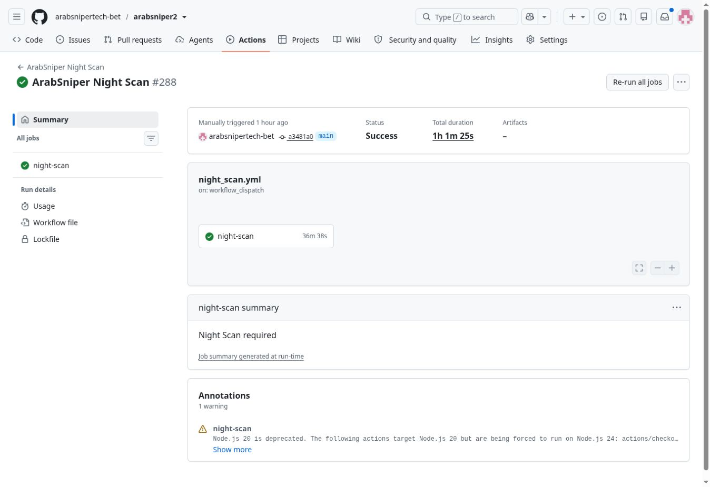
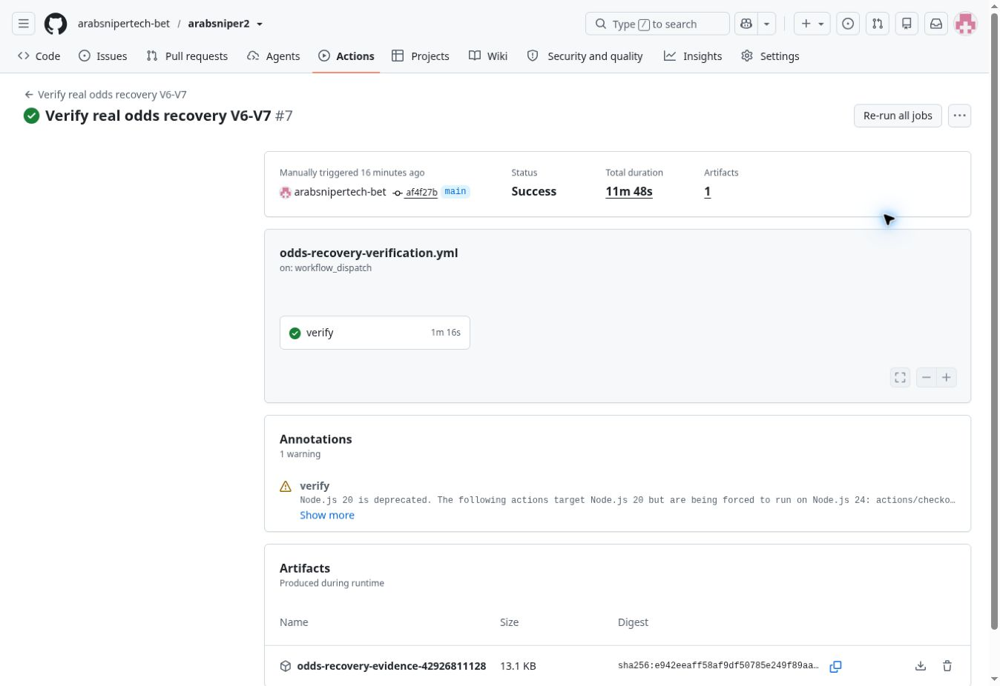

# Recupero quote V6 e integrazione V7 — 10–11 novembre 2026

Mandato: acquisizione anticipata, prima osservazione immutabile per mercato e
bookmaker, rilevazioni temporali persistenti, pubblicazione Gold e verifica reale.

## Punti di ripristino

- Codice iniziale: `bb0c466e132c9baad8ed8f4f7a0f4501325f0a93`.
- Ramo di ripristino: `restore/pre-odds-v6-v7-20261110-bb0c466e`.
- Confronto V6: `09131e57e347c79246f6493d93e52f7215ff204f` del 29 ottobre.
- Il diagnostico verifica anche un manifest R2 immutabile e i checksum dei file
  ripristinati. Il suo SHA-256 è nel rapporto `diagnostic.json` del workflow.
- Manifest iniziale verificato:
  `3276389bb19702346321d54d45e489f1174be832d6083bb1cf67e00f9abea87d`.
- Ripristino in un checkout isolato con le credenziali già configurate:
  `python src/gold_storage.py restore --manifest-sha <SHA256_VERIFICATO>`.
  Questo ripristina i file locali e non sposta il puntatore R2 di produzione.

## Confronto e cause verificate

La raccolta paginata della V6 rimane presente. La versione attuale aggiunge
cataloghi semantici, sorgenti asiatiche equivalenti, limiti HTTP, polling adattivo,
checkpoint privati e motore decisionale V7. Non è stato ripristinato il motore V6.

I commit `c5dc0fec`, `9dc51b5e`, `69bcbc39`, `bb0c466e` sono stati esaminati.
Il primo introduce la precedenza delle quote 1X2; gli altri aggiornano regressioni
che presumevano l'ordine precedente delle richieste. Il workflow finale
`42912744430` è verde: 704 test Python, Node e browser desktop/mobile. I tre run
precedenti sono falliti su quelle aspettative; non erano errori delle formule V7.

Difetti aggiuntivi rilevati e corretti:

1. `odds_collection.py` e `quote_cache.py` mancavano dai percorsi che attivano il
   Fast alla pubblicazione di codice. Ora una correzione alla raccolta attiva una
   raccolta reale e non viene classificata come semplice rivalutazione da cache.
2. La pausa globale delle query improduttive poteva bloccare un 1X2 mancante
   anche quando erano disponibili quote gol. Il recupero dell'esito principale
   rispetta ancora cooldown e budget, ma non eredita quel blocco da altre gare.
3. GG/NG finale mancava dalle famiglie del recupero mirato. Ora è incluso.
4. La ricerca anticipata copre i cinque giorni del Night, con al massimo due
   query mirate per una gara lontana e senza operatori; può cercare i gol anche
   se il provider non offre ancora 1X2. Nessun prezzo viene ricostruito.
5. Le statistiche precedevano le quote: errori o ritardi potevano impedire la
   rilevazione. Le quote del palinsesto vengono ora acquisite prima e riusate
   durante l'analisi con l'orario della rilevazione effettiva.
6. La cache di calcolo limita le serie a 48 punti ed elimina i match dopo due
   giorni. Ora un archivio separato conserva tutte le nuove acquisizioni reali,
   incluse le quote invariate, prima di qualsiasi fusione o selezione.
7. Anche l'aggiornamento V7 di metà ora viene incluso nello storico persistente,
   ripristinando soltanto le partizioni delle gare interessate. L'aggiornamento
   incrementale non può così perdere la prima osservazione o saltare l'archivio.

## Contratto dello storico

`quote_history.py` scrive `arab_quote_price_history_index.json` e partizioni
`arab_quote_price_history_YYYYMMDD_H.json`. Il suffisso distribuisce le gare su
16 file per limitare il lavoro di scrittura nei weekend. La partizione è scelta
alla prima osservazione e resta la stessa anche se la partita viene rinviata.

Ogni serie identifica fixture, bookmaker, mercato/periodo/linea e provenienza.
Ogni rilevazione conserva quota, orario osservato, orario del fornitore, fonte,
query, variazione dalla prima e dalla precedente osservazione e checksum.
La prima osservazione per esito è immutabile e non rappresenta l'apertura
ufficiale del bookmaker. Un archivio referenziato ma assente causa un errore:
non viene creata silenziosamente una nuova prima quota.
Sono ammesse acquisizioni complete e validate. Le risposte HTTP fallite o con
paginazione incompleta vengono segnalate e non diventano prezzi attendibili.

La migrazione copia esclusivamente i punti originali e timestampati del ledger
esistente, senza modificarlo e senza inventare i punti già assenti. Le quote
sintetiche non diventano osservazioni reali. La rilettura della cache non produce
acquisizioni né rinnova la loro età. OCI continua a usare serie omogenee e reali
del ledger di calcolo, non il numero delle richieste HTTP.

L'archivio usa la medesima archiviazione senza perdita, con chunk immutabili,
checksum SHA-256, ripristino verificato e puntatore R2 scritto per ultimo. In caso
di fallimento dello scan, un checkpoint incrementale può conservare soltanto
le osservazioni raccolte, senza pubblicare nuove analisi Gold.

## Diagnosi reale iniziale

Workflow `42914493682` e verifica aggiuntiva `42914803041`, effettuati il
10 novembre, senza scritture in produzione:

| Partita dell'11 novembre | Fixture API | Campionato | API quote | Archivio / Gold |
|---|---:|---|---|---|
| Kawasaki Frontale–Kashiwa Reysol | 1648030 | J-League Cup, 101 | Risposta vuota | Quote assenti |
| Vissel Kobe–Machida Zelvia | 1648031 | J-League Cup, 101 | Risposta vuota | Quote assenti |

Le fixture esistono nel palinsesto. Le risposte generali, per mercati 1, 5, 6,
8 e 34 e per campionato/data non contengono bookmaker o quote. Non sono prezzi
scartati dal parser. Non è possibile trasformare l'esistenza della partita in
una quota che il fornitore non restituisce.

Copertura iniziale dell'intero insieme di cinque giorni, incluse gare già
iniziate/terminate: 247 fixture, 16 con 1X2 completo disponibile in Gold, 382
prezzi gol e 15 gare con OCI. I rapporti successivi distinguono anche le sole
gare future e confrontano V6 e V7 sulla stessa risposta API.

## Collaudo e rilascio

I test aggiunti verificano oltre 48 acquisizioni, prezzi invariati, più HTTP nello
stesso secondo, isolamento degli operatori, migrazione reale, ripristino R2,
rinvio della partita, archivio mancante, rifiuto di dati futuri/post kickoff,
raccolta prima di statistiche fallite e visibilità 1X2 senza pronostico idoneo.

La Gold mostra “Prima osservata → Attuale” e mantiene le quote 1X2 anche se
non esiste un pronostico idoneo. Formule, soglie e file probabilistici V7 non
sono stati modificati.

La PR [#166](https://github.com/arabsnipertech-bet/arabsniper2/pull/166) è stata
integrata dopo il collaudo verde del candidato `a8bc98ea`. Il commit di
integrazione è `a3481a0a4911c5a96e3c840e98fb86e7598cfa3f`.
Il successivo `726c4f3e22018d89d2f945399eae9bd19a915ee9` estende soltanto
il diagnostico in lettura: distingue le osservazioni HTTP già persistite dalle
copie dei punti originali del ledger e dalle nuove richieste del collaudo.
Il commit `af4f27b3372576c9d6074ac055f9675ad6a29f8f` uniforma anche i titoli
dei pannelli interni Gold a “Prima osservata”; non modifica dati o formule.

| Verifica | Esito | Evidenza |
|---|---|---|
| Python, candidato finale | 718 test superati | [42919004909](https://github.com/arabsnipertech-bet/arabsniper2/actions/runs/42919004909) |
| Node e browser desktop/mobile | Superati | Stesso workflow del candidato |
| Test sul commit integrato | Superati | [42919588875](https://github.com/arabsnipertech-bet/arabsniper2/actions/runs/42919588875) |
| Test dopo l'estensione del diagnostico | Superati | [42925807358](https://github.com/arabsnipertech-bet/arabsniper2/actions/runs/42925807358) |
| Test dopo l'uniformazione dei titoli Gold | Superati | [42926698238](https://github.com/arabsnipertech-bet/arabsniper2/actions/runs/42926698238) |
| API reale, V6/V7 e proiezioni Gold | Superati | [42918195851](https://github.com/arabsnipertech-bet/arabsniper2/actions/runs/42918195851) |
| Cloudflare Pages | Build verde e byte del JavaScript identici al codice collaudato | JavaScript `f659fbf7e51c`; [pubblicazione](https://github.com/arabsnipertech-bet/arabsniper2/actions/runs/42926698192) |
| Fast di produzione | Completato con successo | [42919588960](https://github.com/arabsnipertech-bet/arabsniper2/actions/runs/42919588960) |
| Archivio Gold e pagine browser | Completato con successo | [42919589072](https://github.com/arabsnipertech-bet/arabsniper2/actions/runs/42919589072) |
| Night completo | Completato con successo | [42919706014](https://github.com/arabsnipertech-bet/arabsniper2/actions/runs/42919706014) |
| Rilettura R2 dopo Fast e Night, API e Gold | Completata con successo | [42926811128](https://github.com/arabsnipertech-bet/arabsniper2/actions/runs/42926811128) |

Il confronto del 10 novembre, ore 23:50–23:51 di Roma, su quattro gare reali già
quotate, quindi un campione mirato e non l'intero palinsesto, ha ottenuto:

| Partita | Operatori API | Gruppi completi V6 | Gruppi completi attuali |
|---|---:|---:|---:|
| Podbrezová–Zlaté Moravce | 6 | 72 | 85 |
| Artis–FK Jablonec | 9 | 146 | 182 |
| La Luz–Fénix | 9 | 117 | 140 |
| Tacuarembó–Miramar | 9 | 114 | 136 |
| Totale | 33 coppie partita/operatore | 449 | 543 |

Il campione non contiene combo sintetiche nei gruppi conteggiati. Sono state
registrate 1.090 nuove osservazioni HTTP nel collaudo isolato, oltre ai punti originari
importati dal ledger: le prime quote sono rimaste invariate. Per lo stesso
campione, le coppie mercato/operatore disponibili sono 33 per 1X2, 26 per
Over/Under 2,5 FT, 21 per 3,5 FT, 25 per 1,5 PT, 19 per 2,5 PT, 24 per
GG/NG FT e 14 per GG/NG PT. Non si tratta di percentuali di selezioni vincenti.

Prima del rilascio, la Gold conteneva quote 1X2 complete per 5 delle 235 gare
future nei cinque giorni. Il confronto API ha mostrato che le due gare
giapponesi sono prive di prezzi anche nel fornitore. Questi due dati non
dimostrano un recupero completo per ogni gara futura: le quote assenti restano
assenti e la disponibilità viene misurata esplicitamente.

Le sei fixture del controllo sono presenti nelle pagine compresse destinate
al browser; checksum e 1X2 coincidono con il feed Gold. Le quattro gare quotate
producono tre celle 1X2 nel renderer reale; le due giapponesi non producono
numeri inventati. Il browser pubblico richiede l'OTP per l'accesso personale:
non è stata eseguita una sessione manuale autenticata. Il collaudo usa i feed
privati effettivamente pubblicati e lo stesso codice della pagina distribuita.

Il Fast ha acquisito quote e statistiche sui giorni 11 e 12 novembre. I log
attestano rispettivamente 372 e 1.051 esiti con quota recente, 14 e 21 matrici,
senza errori di validazione della cache statistica. Il checkpoint privato
pubblicato contiene 27.960 file e sette feed Gold. Il recupero iniziale ha
verificato 27.855 oggetti R2 prima di iniziare la raccolta: ha richiesto circa
15 minuti e resta il costo operativo prevalente, distinto dalla raccolta API.

Il Night di produzione ha ripristinato 27.961 file, completato tutti i cinque
giorni e pubblicato un nuovo checkpoint con 28.116 file, sette feed Gold e 21
pagine browser verificate. Sono stati caricati 280 oggetti modificati, senza
riscrivere gli oggetti immutabili invariati. La durata del job è stata 36m38s.

| Giorno | Partite visibili | Matrici V7 | Esiti con quota recente |
|---|---:|---:|---:|
| 11 novembre | 16 | 14 | 372 |
| 12 novembre | 22 | 21 | 1.051 |
| 13 novembre | 28 | 28 | 159 |
| 14 novembre | 168 | 168 | 0 |
| 15 novembre | 111 | 111 | 0 |

Gli esiti sono righe di mercato del modello, non bookmaker distinti né
pronostici idonei. Il feed conserva anche tre record senza una nuova matrice
prematch V7. Zero indica nessun prezzo recente utilizzabile in quel momento,
non una quota o una probabilità pari a zero.

Nel log del Night compare un errore transitorio API-Football `fixtures/5xEr`
durante l'analisi Queen's University–Dundela. Il workflow ha proseguito nel
percorso di gestione degli errori e si è concluso con successo; non risultano
errori delle richieste quote né errori di validazione della cache statistica.

## Riscontro definitivo dopo la pubblicazione

La rilettura dell'11 novembre, ore 01:02–01:03 di Roma, è stata effettuata dal
workflow `42926811128` sul codice `af4f27b3`, senza scrivere dati in produzione.
Ha verificato il manifest immutabile:
`f276035705463234e405f6b3b3f549d074369f7f28ad56b3577748139eaf1875`.

Prima di eseguire nuove richieste API, il diagnostico ha letto da R2:

| Contenuto persistito | Quantità |
|---|---:|
| File/partizioni dello storico, incluso indice | 74 |
| Serie partita/mercato/bookmaker/fonte | 25.913 |
| Rilevazioni totali | 95.614 |
| Nuove osservazioni HTTP di produzione | 21.958 |
| Punti originali copiati dal ledger esistente | 73.656 |
| Rilevazioni con altre provenienze | 0 |

Questi numeri escludono le richieste del diagnostico: dimostrano il salvataggio
effettivo dei writer di produzione. Sulle quattro gare del confronto iniziale
sono state confrontate 33 serie 1X2 e 99 prime quote, con i rispettivi timestamp:
**99 su 99 sono identiche**. Le stesse serie contengono 66 nuove osservazioni
HTTP persistite; l'ultima lettura Night risale alle 00:40:21–00:40:24 dell'11
novembre, prima delle analisi e della pubblicazione finale.

Esempi dello stesso esito e dello stesso operatore, presenti anche nella Gold:

| Partita | Bookmaker / segno | Prima osservata, ora di Roma | Ultima lettura Night | Variazione |
|---|---|---|---|---:|
| Artis–FK Jablonec | Betano / 1 | 3,60 — 10/11 10:51:15 | 4,15 — 11/11 00:40:23 | +15,28% |
| La Luz–Fénix | Pinnacle / 1 | 2,69 — 10/11 00:21:17 | 2,55 — 11/11 00:40:23 | −5,20% |

La rilettura di un prezzo invariato viene conservata nell'archivio HTTP e non
crea un nuovo movimento OCI. Il timestamp del fornitore e quello della lettura
restano distinti. La Gold conserva l'OCI quando esistono serie confrontabili:
15 gare nel feed verificato, senza sostituire un dato mancante con zero.

### Copertura finale misurata

Archivio e Gold coincidono: 345 record nei cinque giorni 11–15 novembre, 342
con identificatore di pubblicazione `arabsniper-v7.0` e tre record strutturali
legacy. Fra le 344 gare ancora future, **21 hanno 1X2 completi recenti o da cache
valida: 6,10%**; le stesse 21 hanno prezzi gol disponibili. Nel feed sono
presenti 544 prezzi gol recenti/validi. I prezzi scaduti eventualmente conservati
restano indicati come dati da confermare e non vengono conteggiati qui.

La fotografia iniziale era riferita al palinsesto 10–14 novembre, quella finale
all'11–15: il confronto globale non misura da solo l'effetto della modifica.
Nel nuovo confronto API sulle stesse quattro gare quotate ci sono 34 coppie
partita/bookmaker e 562 gruppi completi con il parser attuale contro 462 con
quello V6, usando le medesime risposte. Un operatore aggiuntivo rispetto al
controllo iniziale è diventato visibile al fornitore nel frattempo; disponibilità
API e successive acquisizioni di produzione seguono i rispettivi orari.

Tutte le otto fixture del controllo finale, incluse due ulteriori gare di ritorno
giapponesi presenti nel palinsesto, coincidono fra feed Gold e pagine browser
compresse verificate. Le quattro gare quotate mostrano tre celle 1X2 reali e la
dicitura “Prima osservata”. Le due partite richieste dell'11 novembre restano
senza quote nelle risposte generali, mirate 1/5/6/8/34 e campionato/data, tutte
complete e senza errori. I test e le diagnosi non hanno inventato prezzi.

Il controllo ha consumato 63 richieste HTTP, entro i budget verificati, e ha
confermato risposta 200 della Gold pubblica, risposta 200 del JavaScript e
identità byte per byte fra asset distribuito e sorgente collaudato.

Gli esiti sintetici delle verifiche sono conservati in
[odds-recovery-evidence-20261111.json](evidence/odds-recovery-evidence-20261111.json).
I controlli `42924310063` e `42925885371` sono stati annullati mentre erano in
coda, per sostituirli con la verifica dell'ultima versione; non hanno scritto dati.

## Limiti operativi verificati

- Una risposta vuota del fornitore non consente di ottenere una quota reale.
  La copertura del campione quotato e quella dell'intero palinsesto sono
  misure diverse; il campione non è una prova di copertura universale.
- Il ripristino integrale degli archivi richiede circa 15 minuti. Il percorso
  incrementale V7 ripristina soltanto le partizioni necessarie; Night e Fast
  conservano il ripristino integrale verificato.
- Le vecchie rilevazioni già assenti dalla cache non vengono ricreate. I
  checkpoint immutabili e gli archivi precedenti restano recuperabili.
- L'aggiornamento V7 di metà ora è verificato dai test d'integrazione. La
  finestra diurna non viene forzata artificialmente durante questo collaudo
  notturno.
- L'accesso manuale Gold con OTP non è stato effettuato. Sono verificati i
  feed privati pubblicati, le pagine compresse, il renderer e l'asset distribuito.
- GitHub mostra un'annotazione di deprecazione Node.js 20 nelle azioni
  utilizzate. È un avviso non bloccante nelle esecuzioni verificate, tutte verdi.

Stato finale: correzioni pubblicate e collaudo in produzione completato con
test verdi, Fast verde, Night verde, rilettura R2 verificata e pubblicazione
Cloudflare verificata. Le quote assenti dal provider e i limiti operativi sopra
elencati restano espliciti; non viene dichiarata copertura universale.

## Prove visive dei workflow conclusi

